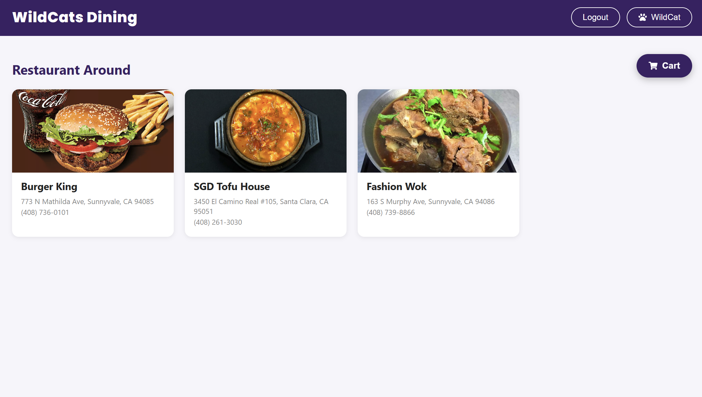
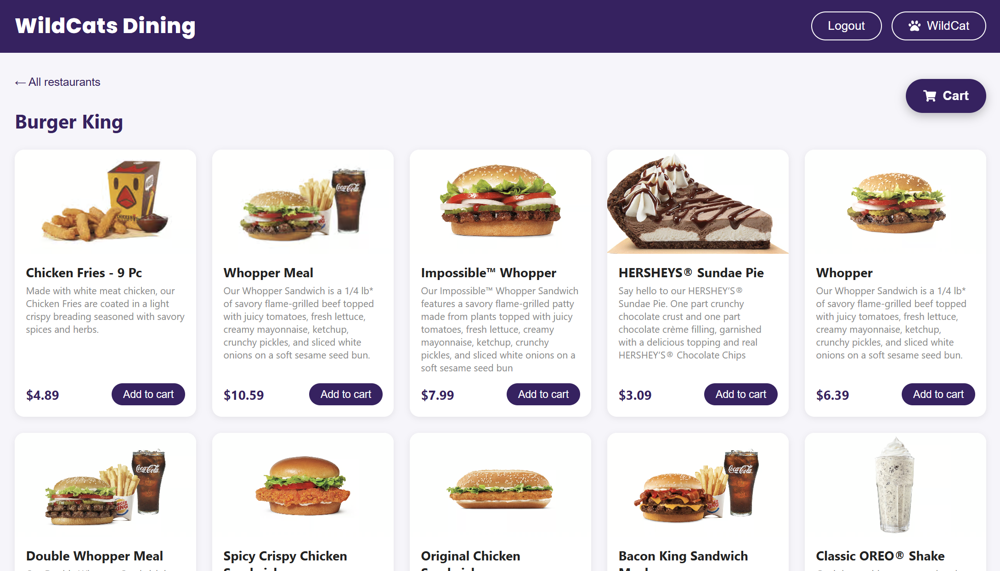
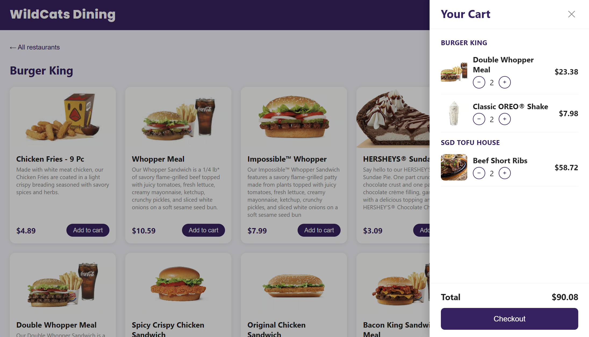
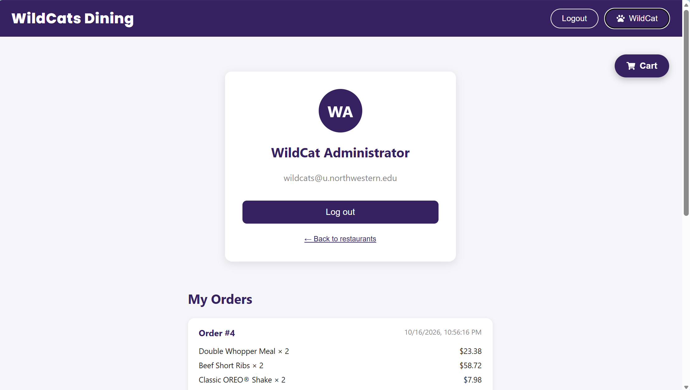

# 🐾 WildCats Dining

A full-stack food ordering web app inspired by DoorDash, built for Northwestern students. Users can browse restaurants, add dishes to a cart, check out, and view their order history.

## Screenshots

| Home | Menu |
|---|---|
|  |  |

| Cart | Profile & Orders |
|---|---|
|  |  |

## Features

- **Browse** restaurants and their menus
- **Authentication**: sign up, log in, log out (session-based with Spring Security), stays logged in after page refresh
- **Shopping cart**: add items, increase / decrease quantity, items grouped by restaurant
- **Checkout**: turns the cart into an order in a single database transaction
- **Profile page**: user info and order history
- Toast notifications and confirmation dialogs for a smoother UX

## Tech Stack

| Layer | Technologies |
|---|---|
| Frontend | React 19, JavaScript, CSS, react-icons |
| Backend | Java 21, Spring Boot 4, Spring Security, Spring Data JDBC, Caffeine cache |
| Database | PostgreSQL 15 (Docker) |

## Project Structure

```
WildcatsDining/
├── frontend/   # React single-page app (port 3000)
└── backend/    # Spring Boot REST API (port 8080)
```

## API Endpoints

| Method | Path | Description | Login required |
|---|---|---|---|
| POST | `/signup` | Create an account | No |
| POST | `/login` | Log in (form data) | No |
| POST | `/logout` | Log out | No |
| GET | `/me` | Current user info | Yes |
| GET | `/restaurants/menu` | All restaurants with their menus | No |
| GET | `/restaurant/{id}/menu` | Menu of one restaurant | No |
| GET | `/cart` | Current user's cart | Yes |
| POST | `/cart` | Add an item to the cart | Yes |
| POST | `/cart/decrease` | Decrease an item's quantity | Yes |
| POST | `/cart/checkout` | Place an order from the cart | Yes |
| GET | `/orders` | Current user's order history | Yes |

## How to Run Locally

**Prerequisites:** Node.js, Java 21, Docker Desktop

**1. Start the database**
```bash
cd backend
docker compose up -d
```

**2. Start the backend** (http://localhost:8080)
```bash
cd backend
./gradlew bootRun        # Windows: .\gradlew.bat bootRun
```
The database tables and sample data are created automatically on startup.

**3. Start the frontend** (http://localhost:3000)
```bash
cd frontend
npm install
npm start
```

**Test account:** `wildcats@u.northwestern.edu` / `12345`

## Author

Huizeyuanyang — [GitHub](https://github.com/Huizeyuanyang)